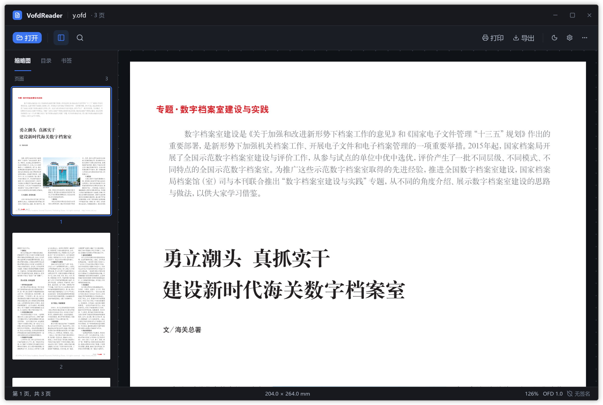
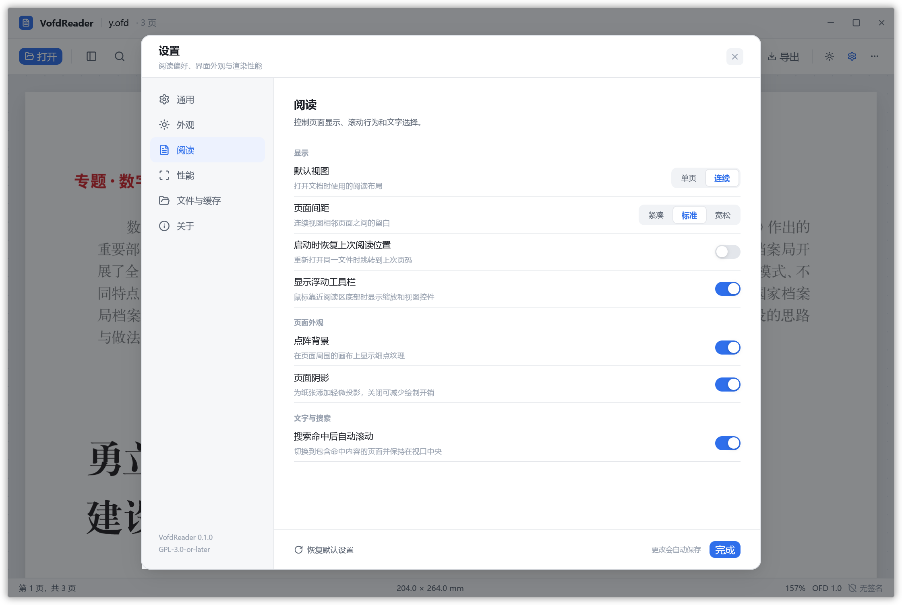
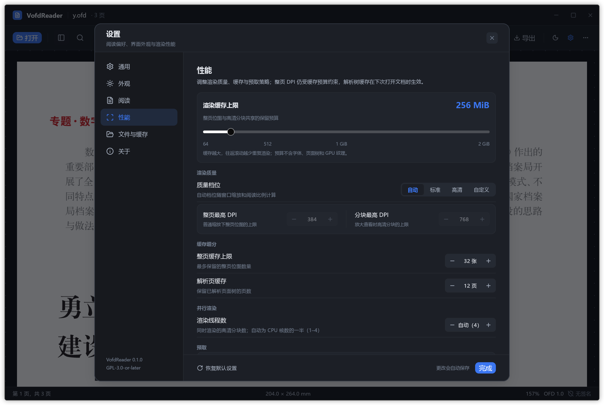

# VofdReader


> 用 Rust + GPUI 编写的轻量 OFD 阅读器。只做阅读，把**打开快、翻页顺、字迹清、内存低**做好。

依据国家标准 **GB/T 33190-2016《电子文件存储与交换格式 版式文档》**，许可证 **GPL-3.0-or-later**。

> **Vibe Coded**：本项目采用 AI 编程助手协作的 Vibe Coding 方式开发。需求、取舍、审查与发布由维护者负责；AI 生成的代码均经过测试~~人工检查~~人工功能测试。**代码没有经过审查，完全没有。**

---

## 功能

- **单页 / 连续视图**：连续视图按页宽排列，支持滚轮平滑滚动、键盘滚动和页面虚拟化。
- **缩略图侧栏**：按页宽比例显示缩略图，默认关闭，可从工具栏或设置开启。
- **页面总览**：以网格查看全部页面，点击页面跳转；支持 `↑/↓`、`J/K` 选择。
- **缩放与旋转**：缩放、适应宽度、适应页面、顺时针 90° 旋转；旋转同步页面、搜索高亮和选择坐标。
- **搜索**：检索正文与背景模板文字，结果按页列出，当前页命中以黄色高亮显示。
- **文本选择**：拖选当前页文字，`Ctrl/Cmd+C` 复制，`Esc` 清除；印章和水印不参与选择。
- **浮动工具栏**：靠近阅读区底部时显示，提供缩放、适应页面、单页/连续切换、旋转和页面总览。
- **文档信息**：在“更多”菜单中打开模态窗口，显示格式、页数和页面尺寸、文件大小、作者、日期、签名状态和完整路径。
- **亮暗主题**：跟随系统或手动切换，工具栏、组件和弹窗同步更新。
- **导出**：当前页导出为 PNG 或 SVG；PNG 默认 144 DPI，可在保存对话框中改用其他格式。
- **持久化设置**：阅读、外观、性能、文件和最近文件均可调整并自动保存。
- **原生渲染**：无 WebView、无网络、无遥测。

## 界面预览

### 亮色主界面

[](docs/screenshots/main-light.png)

### 暗色主界面

[](docs/screenshots/main-dark.png)

### 设置 · 阅读

[](docs/screenshots/settings-light.png)

### 设置 · 性能

[](docs/screenshots/settings-performance-dark.png)

> 以上为实际运行截图。

## 构建与运行

需要 Rust 工具链；CI 固定使用的版本见 [CI 配置](.github/workflows/ci.yml) 中的 `RUST_TOOLCHAIN`。Linux 还需要 Vulkan、Wayland 或 X11、fontconfig 开发库；Arch Linux 依赖同样见该配置。

```bash
cargo run -p ofd-app -- resources/y.ofd
```

也可以不传文件启动，然后通过文件对话框或拖放打开 OFD。最近文件和配置保存在用户配置目录：

- Linux：`~/.config/vofdreader/`
- macOS：`~/Library/Application Support/vofdreader/`
- Windows：`%APPDATA%\vofdreader\`

首次构建 GPUI Kit 依赖通常需要几分钟。

## 使用

### 快捷键

- `Ctrl/Cmd+F`：搜索
- `Ctrl/Cmd+,`：设置
- `Ctrl/Cmd+滚轮`：缩放
- `+` / `-`：缩放
- `0`：适应页面
- `R`：顺时针旋转
- `G`：页面总览
- `Home` / `End`：首页 / 末页
- 连续视图：`↑/↓`、`J/K`、滚轮滚动；`PageUp/PageDown`、`Space/Shift+Space` 按屏滚动
- 单页视图：`←/→/↑/↓`、`PageUp/PageDown`、`J/K`、滚轮翻页

### 打开方式

文件对话框、命令行参数、拖入窗口，或从空状态页的最近文件打开。

### 设置

设置窗口分为通用、外观、阅读、性能、文件与缓存、关于六类。可调整主题、侧栏默认状态、默认视图、页面间距、恢复阅读位置、浮动工具栏、点阵/阴影、搜索滚动、渲染质量与 DPI 上限、缓存/预取、渲染线程数、导出格式与 PNG DPI，并可清理最近文件和内存缩略图。

Linux 的界面字体通过系统 `fc-match` 获取 fontconfig 默认 sans 字体，并读取一个中文 sans 回退字体；macOS / Windows 使用 GPUI 默认系统界面字体。OFD 内嵌字体仍按文档自身资源渲染。

## 渲染

页面路径：

```text
DisplayList → SVG → usvg/resvg → BGRA → GPUI GPU 纹理
```

- 页面和缩略图在后台线程渲染，按窗口缩放和显示比例计算 DPI。
- 高倍缩放及大页面使用可见区域高清分块，整页低清预览兜底；导出保持整页。
- 连续视图按可见区域虚拟化，滚动中复用已有位图，停止后补充清晰页。
- 渲染缓存默认 256 MiB（整页 192 MiB、分块 64 MiB），可在设置中调整。
- 页面缓存淘汰、切换文档和退出时清理 GPU 图片条目。
- 内嵌字体优先：支持 TTF/OTF、裸 CFF、CID 映射、TTC/OTC 选面和逐字回退。

详细实现见 [字体说明](docs/FONTS.md)、[性能记录](docs/PERF.md) 和 [GPU 性能核验](docs/GPU_PERF.md)。

## 命令行

```bash
cargo run -p ofd-cli -- info  resources/y.ofd
cargo run -p ofd-cli -- pages resources/y.ofd
cargo run -p ofd-cli -- text  resources/y.ofd
cargo run -p ofd-cli -- check resources/y.ofd

# 导出整页 SVG
cargo run -p ofd-cli -- render resources/y.ofd --page 0 --svg /tmp/page.svg

# 光栅化为 PNG
cargo run -p ofd-cli -- render resources/y.ofd --page 0 --png /tmp/page.png --dpi 144
```

CLI 支持 `info`、`pages`、`text`、`check`、`fonts`、`render` 子命令。

## 测试语料

`resources/` 包含发票、公文、水印、图案、裁剪、图片覆盖和异常路径等 OFD/PDF 测试文档，来自开源项目 [ofdrw](https://github.com/ofdrw/ofdrw)，按其 MIT License 使用。来源和许可说明见 [`resources/README.md`](resources/README.md)。

```bash
# 全量页面渲染检查
./scripts/render-corpus.sh resources /tmp/ofd-render-corpus

# 全量内嵌字体核验
./scripts/check-fonts.sh resources

# 单元、集成和工作区测试
cargo test --workspace
```

当前测试语料共 40 个 OFD、118 页，全部可渲染；内嵌字体引用无空白字符回退。

## 工程结构

```text
crates/
├── ofd-core/   # 容器 / 模型 / 资源 / 注释 / 文字 / DisplayList / SVG / resvg
├── ofd-cli/    # info / pages / text / check / fonts / render
└── ofd-app/    # GPUI Kit 桌面阅读器
```

依赖方向：`ofd-app → ofd-core`、`ofd-cli → ofd-core`；core 不依赖 GPUI。

## 已知限制

- 打印、目录/书签入口暂未实现。
- 签名印章外观已渲染，但不执行 SM2/SM3 验签，状态栏显示“含签名（未验证）”。
- 文本选择目前仅限当前页，按阅读顺序选择，不支持双击选词和跨页选择。
- 图案填充按路径包围盒平铺，尚未按任意路径轮廓裁剪。
- 图元 `Clips` 支持路径裁剪区（含 `TransFlag`），文字裁剪区暂未支持；`AxialShd` / `RadialShd` 渐变已支持，`RadialShd` 的 `Eccentricity` / `Angle` 椭圆参数按圆形处理。
- `CharDirection` / `ReadDirection` 支持四个正交方向。
- 签章图片以正片叠底（multiply）方式叠加，不透明白底的印章不会遮挡下方文字。
- 缩略图会为前 80 页排队生成。
- 导出仅限当前页。

## 文档

| 文档 | 内容 |
| --- | --- |
| [`docs/FONTS.md`](docs/FONTS.md) | 字体解析、内嵌字体核验和界面字体策略 |
| [`docs/PERF.md`](docs/PERF.md) | 渲染、调度、缓存和预取性能记录 |
| [`docs/GPU_PERF.md`](docs/GPU_PERF.md) | GPU 纹理生命周期、绘制诊断和 Linux 采样 |
| [`docs/DEPENDENCIES.md`](docs/DEPENDENCIES.md) | 依赖与 Cargo 特性说明 |
| [`docs/SETTINGS.md`](docs/SETTINGS.md) | 设置界面和配置持久化 |
| [`docs/WINDOW_DECORATIONS.md`](docs/WINDOW_DECORATIONS.md) | 自绘窗口装饰和圆角实现 |
| [`docs/coordinates.md`](docs/coordinates.md) | 样本坐标与排版验证记录 |

## 说明

- 本项目不收录 GB/T 33190-2016 标准原文；标准信息见[全国标准信息公共服务平台](https://openstd.samr.gov.cn/bzgk/std/newGbInfo?hcno=3AF6682D939116B6F5EED53D01A9DB5D)。
- GPL-3.0-or-later；发布二进制时需同时提供对应源码。
- 自行加入的 OFD 样本请先脱敏，并确认有权再分发。
