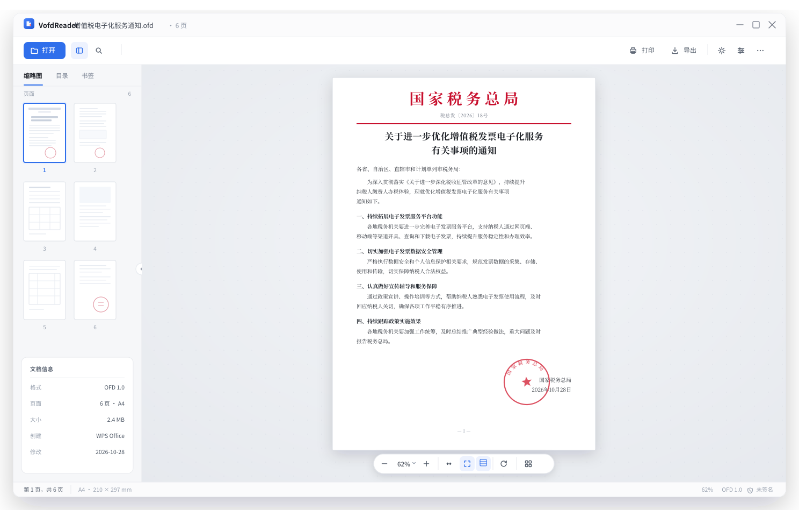
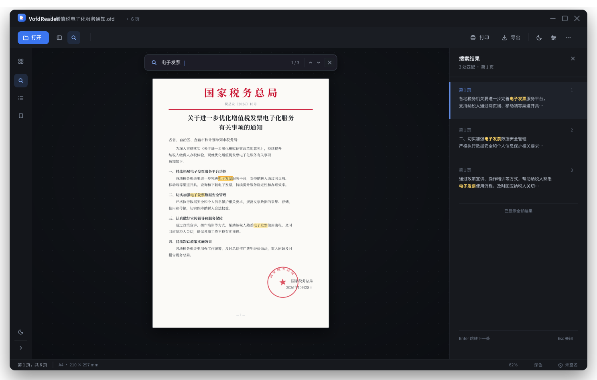
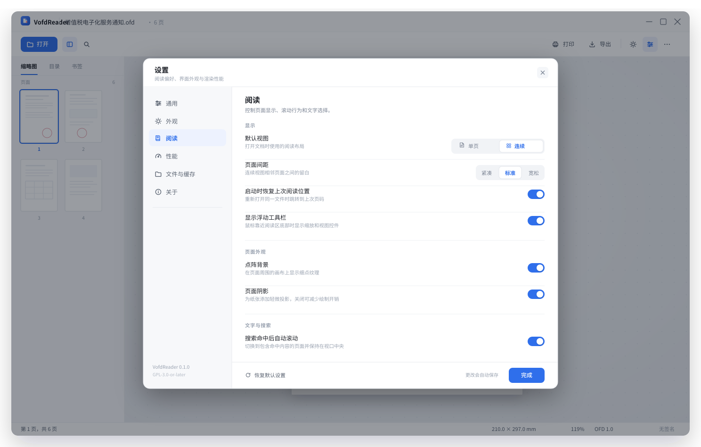
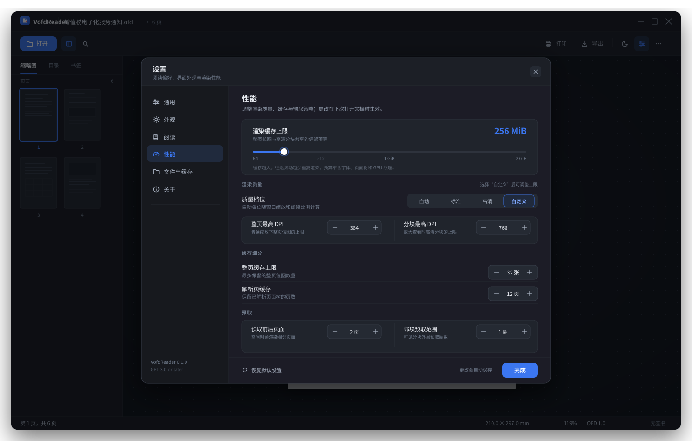

# VofdReader

> 用 Rust + GPUI 编写的轻量 OFD 阅读器。只做阅读，把**打开快、翻页顺、字迹清、内存低**做好。

依据国家标准 **GB/T 33190-2016《电子文件存储与交换格式 版式文档》**。

**当前状态：M1 解析完成；M2/M3 渲染首版完成；M4 的 GPUI Kit 阅读器已能在真实发票上运行（含缩略图侧栏与后台渲染）。**
许可证：**GPL-3.0-or-later**。

---

## 运行阅读器

```bash
# 首次构建 GPUI Kit 依赖约需 3–4 分钟
cargo run -p ofd-app -- fixtures/private/sample-invoice.ofd
```

界面已按 SVG 原型对齐：

- 自绘 44px 标题栏（应用名、文件名、页数、窗口控制）；
- 52px 工具栏（打开 / 侧栏 / 搜索 / 打印 / 导出 / 主题 / 设置 / 更多）；
- 240px 侧栏（缩略图 / 目录 / 书签标签、单列全宽缩略图）；
- 单页 / 连续视图切换；连续视图按页宽排列、滚轮平滑滚动；
- 浮动缩放条（缩小/放大、缩放百分比、适应宽度、适应页面、单页/连续切换、顺时针旋转、页面总览网格）；
- 28px 状态栏（页码、纸张尺寸、缩放、版本、签名状态）；
- 工具栏、缩放条、状态栏图标全部替换为 **gpui-kit 内置 Lucide 图标**；
- 阅读区加入与原型一致的点阵底纹、页面阴影和居中布局；
- 主窗口参照 Zed 实际工作区装饰：**5px** 外圆角、10px 阴影留白、居中黑色 40% / blur 5px 阴影；平铺贴边取消对应圆角和边框，全屏不绘制客户端装饰。
- 修复 GPUI Kit 自动装饰与应用装饰重复叠加的问题；顶部、底部背景单独设置内圆角，不依赖 GPUI 尚不支持的圆角裁切。实现来源与本地依赖补丁见 [窗口装饰说明](docs/WINDOW_DECORATIONS.md)。

打印、目录/书签当前是占位按钮，后续接入。
页面渲染与缩略图都在后台线程执行；页面按“窗口缩放 × 适应比例 × 缩放倍数”计算设备像素密度光栅化，HiDPI（如 1.75×）下不再放大低分辨率位图；缩略图固定 48 DPI。

Linux 通过 `fc-match` 使用 fontconfig 的默认 sans 字体，并读取一个中文 sans 回退家族；macOS / Windows 使用 GPUI 默认系统界面字体。OFD 内嵌字体仍按文档自身资源渲染。详见 [字体说明](docs/FONTS.md)。

连续视图采用可见区域虚拟化。滚动中复用位图/缩略图，停止约 160ms 后再补清晰页；前景页面串行渲染，按内存预算限制工作集，缩略图避让滚动，避免快速滚动时堆积渲染任务。详见 [性能记录](docs/PERF.md)。

页面缓存淘汰和切换文档会同步清理 GPU 图片条目；点阵背景复用几何并剔除被页面遮住的点。可开启绘制诊断和 Linux 进程级 GPU 采样，详见 [GPU 性能核验](docs/GPU_PERF.md)。

高倍缩放及大页面使用可见区域高清分块，整页低清预览兜底；单页/连续视图均支持，导出不分块。桌面接缝观感与 GPU 收益仍需在可控可见窗口中复测。

渲染结果缓存默认预算为 256 MiB（整页 192 MiB、分块 64 MiB），整页最多保留 32 张，按需使用以减少往返滚动的重复渲染。设置窗口可调整缓存、预取和高清分块范围；配置保存在用户配置目录的 `vofdreader/settings.json`。这不是进程总内存上限。

可见内容就绪后，空闲时预渲染前后各 2 页的低清预览及可见高清块外围 1 圈；滚动中暂停启动新预取，全部结果仍受现有缓存预算约束。预取范围和分块数量可在设置窗口中调整。

- **导出**：保存当前页为 PNG（144 DPI）或 SVG；在保存对话框中把扩展名写成 `.svg` 即导出矢量。结果通过状态栏提示，不弹阻塞对话框。
- **亮暗主题**：工具栏太阳/月亮按钮即时切换，组件主题（按钮、滚动条、弹窗、窗口边框）同步；当前不记忆选择。
- **侧栏**：默认关闭，打开文档时仅显示阅读区；可在工具栏或设置中开启。缩略图单列铺满侧栏宽度，按页面比例缩放，底部不再常驻文档信息卡。
- **文档信息**：工具栏“更多”菜单中的“文档信息”打开模态窗口，显示标题、文件、格式、文档 ID、页数与当前页尺寸、大小、作者、创建者、创建/修改日期、签名状态和完整路径；`Esc`、右上角关闭按钮或点击遮罩关闭。
- **搜索**：工具栏搜索按钮或 `Ctrl/Cmd+F` 打开顶部搜索条；检索页面正文和背景模板文字（发票标题、表格标签也可命中），结果按页列出；`Enter`/`Shift+Enter` 或点击结果跳转，当前页的全部命中以黄色半透明矩形标出，`Esc` 或 × 关闭。
- **文本选择**：在页面上拖动选择文字，蓝色高亮当前选区；`Ctrl/Cmd+C` 复制，复制结果按行拼接，`Esc` 清除选择。当前只支持当前页的线性阅读顺序选择，注释印章/水印不参与选择。
- **浮动缩放条**：默认隐藏，仅当鼠标靠近阅读区底部中央时显示；停留在工具栏上保持显示，离开后约 2.5 秒自动隐藏。在正文、侧栏等其他区域移动鼠标不会唤出工具栏。
- **旋转**：每次顺时针旋转 90°，搜索高亮、文字选择和高倍分块使用同一坐标变换；旋转后重新光栅化当前视图，切换文档时保持当前方向。
- **页面总览**：网格按钮打开页面缩略图总览，点击页面跳转并关闭；`Esc` 关闭，`↑/↓`、`J/K` 移动当前页。缩略图不足的页面显示页码占位。
- **设置**：工具栏设置按钮或 `Ctrl/Cmd+,` 打开模态窗口；可调整主题、侧栏、默认视图、页面间距、恢复位置、浮动工具栏、点阵/阴影、搜索滚动、渲染质量与 DPI 上限、缓存/预取、导出格式与 PNG DPI，并清理最近文件和缩略图缓存。修改即时生效并自动保存；缓存细分在下次打开文档时使用新值。

快捷键：连续视图中 `↑/↓`、`J/K` 或鼠标滚轮滚动，`PageUp/PageDown`、`Space/Shift+Space` 按屏滚动；单页视图中 `←/→/↑/↓`、`PageUp/PageDown`、`J/K` 或鼠标滚轮翻页；`Home/End` 首页/末页，`+/-` 缩放，`0` 适应页面，`R` 顺时针旋转，`G` 页面总览，`Ctrl/Cmd+,` 打开设置，`Ctrl/Cmd+F` 搜索，搜索框中 `Enter`/`Shift+Enter` 切换命中。

打开方式：文件对话框、命令行参数、把 OFD 文件拖进窗口，或从空状态页的“最近打开”选择。最近文件保存在用户配置目录，最多 10 条，路径失效时自动跳过。

> 首次构建需要系统具备 Vulkan / Wayland（或 X11）/ fontconfig 开发库；CI 中已列出 Ubuntu 依赖。

### 渲染命令

```bash
# 导出整页 SVG（含模板、正文、印章、旋转水印）
cargo run -p ofd-cli -- render fixtures/private/sample-invoice.ofd --page 0 --svg /tmp/invoice.svg

# 光栅化为 PNG
cargo run -p ofd-cli -- render fixtures/private/sample-invoice.ofd --page 0 --png /tmp/invoice.png --dpi 144
```

真实发票样本的渲染结果已人工核对：模板表格、正文位置、二维码、红色监制章（Darken 混合去白底）、右侧旋转水印均正确。

---

## 原型

### 亮色主界面

[](docs/prototype/01-main-light.svg)

### 暗色搜索

[](docs/prototype/02-search-dark.svg)

### 设置 · 阅读（亮色）

[](docs/prototype/03-settings-light.svg)

### 设置 · 性能（暗色）

[](docs/prototype/04-settings-performance-dark.svg)

> SVG 为可缩放矢量稿，点击图片或直接打开 `docs/prototype/*.svg` 查看。在浏览器中打开后，点击主界面搜索图标可切换到搜索原型；点击设置图标可打开设置原型，点击设置窗口右上角关闭可返回。设置原型采用左侧分类、右侧即时生效的开关/分段控件/步进器，底部“完成”关闭，不设置额外的“应用”按钮。原型按当前未签名样本展示“未签名”状态；SM2/SM3 验签后置到 v1.0。

---

## 命令行与解析

```bash
cargo run -p ofd-cli -- info  fixtures/private/sample-invoice.ofd
cargo run -p ofd-cli -- pages fixtures/private/sample-invoice.ofd
cargo run -p ofd-cli -- text  fixtures/private/sample-invoice.ofd
cargo run -p ofd-cli -- check fixtures/private/sample-invoice.ofd
cargo test
```

已实现：

- ZIP 容器、`ST_Loc` 规范化、大小写容错、ZIP 炸弹限额；
- `OFD.xml` / `Document.xml` / 页面 / 资源 / 注释解析；
- 模板页、`DrawParam` 继承、颜色/透明度、图像资源；
- `CompositeObject` → `CompositeGraphicUnit` 可复用复合对象，含组透明度和嵌套内容；
- `DisplayList`：Path / Text / Image / Group；
- SVG 导出；内嵌字体按字形轮廓绘制、`usvg + resvg` 光栅化；
- 注释外观：水印图片、旋转文字、`BlendMode="Darken"`；
- 文本颜色继承所在 `Layer` / `PageBlock` 的 `DrawParam.FillColor`（修正发票模板中“合计”“价税合计”等红字被渲染成黑色的问题）；
- `CGTransform` 校验；文字逐字定位与提取；
- `DeltaX` 的 `g N X` 批量缩写展开、`DeltaY` 竖排逐字定位；
- 字体/图片路径大小写不敏感解析，支持 `BaseLoc="/"` 与包内绝对路径；
- 内嵌字体优先：支持 TTF/OTF、裸 CFF、CID 映射及 TTC/OTC 选面；按 `CGTransform` 字形簇或 cmap 输出路径，支持合字/展开、方向/横向缩放和粗斜体；屏幕与 SVG 导出递归处理所有内容组，缺字逐字回退并提示。40 份语料的内嵌字形核验为 0 回退，详见 [字体核验](docs/FONTS.md)；
- `FillColor/Pattern` 图案填充按 CellContent 平铺（修复水印测试文档整页变黑）；
- 缩略图侧栏、后台渲染、页面缓存与代际号取消；
- 手工构造的最小 OFD 集成测试 + 坐标矩阵/路径解析单元测试。

### 测试语料

`resources/` 下放置了发票、公文、水印、图案、裁剪、图片覆盖、异常路径等 OFD 测试文档。可执行：

```bash
./scripts/render-corpus.sh resources /tmp/ofd-render-corpus
```

脚本会渲染每个文档的每一页并报告失败页；当前语料为 **40 个 OFD、118 页，全部可渲染**。空白页仅出现在与 PDF 对照样本本就为空的页面。

真实发票样本（仅结构统计）：

| 项 | 结果 |
| --- | --- |
| 页面 | 1 页，210×140 mm |
| 对象 | 26 文字 + 1 图形 + 1 图像 |
| 模板 | 背景模板 1 个 |
| 字体 | 5 个（3 个内嵌子集，2 个系统回退） |
| 注释 | 2 个 Watermark（红色监制章图片 + 旋转文字水印） |
| 签名 | 无 `Signs/`；v0.1 仅检测材料，验签后置 v1.0 |

> 该样本含真实发票信息，已放入 `fixtures/private/` 并在 `.gitignore` 中排除，不会入库。

---

## 设计要点

- **原生轻量**：Rust + GPUI Kit，无 WebView、无网络、无遥测。
- **显示列表驱动**：解析层输出 `DisplayList`，与 UI/渲染后端解耦；当前走 `DisplayList → SVG → resvg`。
- **印章不是可选项**：真实发票的监制章位于 `Watermark` 注释外观流中，必须渲染；白底靠 `Darken` 混合处理。
- **签名印章外观**：解析 `Signatures.xml → Signature.xml`，从 `Seal/BaseLoc` 或 `SignedValue` 中读取印章；支持 PNG/JPEG 和 ASN.1 中的 OFD 矢量印章，后者保留透明背景。按 `StampAnnot` 的 `PageRef`、`Boundary`、`Clip` 叠加印章切片；只展示外观，不做验签。
- **签名状态不误导**：只显示“无签名 / 含签名（未验证）”；SM2/SM3 验签后置到 v1.0。
- **三平台**：Windows / macOS / Linux 同步推进；当前仅在 Linux 上人工运行验证。

---

## 已知限制（M4 进行中）

- 极高缩放仍会位图放大（光栅上限 384 DPI，约覆盖 1.75× 屏 200% 缩放）；
- 打印、目录/书签尚未接入（按钮与 Lucide 图标已就位）；设置窗口已接入阅读、外观、性能、文件缓存和关于页；导出、亮暗主题、搜索、页内高亮与文本选择/复制已可用；选择目前仅限当前页且按阅读顺序，未做双击选词/段落；
- 暂未处理任意路径 `Clips`；`CharDirection` / `ReadDirection` 已支持四个正交方向。导出 SVG 中路径化文字不能按文本选中，阅读器的搜索和选择仍使用 DisplayList；其他验证边界见 [字体核验](docs/FONTS.md)；
- 签名印章外观已提前渲染（含跨页 `Clip` 切片）；签名有效性仍不校验，状态栏保持“含签名（未验证）”；
- 图案填充按路径包围盒平铺，尚未按任意路径轮廓裁剪；
- 多页文档的页面尺寸在后台补齐，但缩略图仍会为前 80 页排队；
- 主题选择不持久化，导出仅限当前页；最近文件保存路径，不保存文档内容；
- 签名验签（SM2/SM3）与打印、导出安装包待后续里程碑。

---

## 文档

| 文档 | 内容 |
| --- | --- |
| [`docs/PLAN.md`](docs/PLAN.md) | 完整开发计划：范围、格式要点、架构、渲染管线、UI、里程碑、测试、风险 |
| [`docs/coordinates.md`](docs/coordinates.md) | 真实样本的坐标/排版规则与首版验证记录 |
| [`docs/PERF.md`](docs/PERF.md) | 渲染各阶段基准、调度/缓存/内部 SVG 优化记录与后续计划 |
| [`docs/DEPENDENCIES.md`](docs/DEPENDENCIES.md) | 依赖与 Cargo 特性精简说明 |
| [`docs/SETTINGS.md`](docs/SETTINGS.md) | 设置界面说明、配置持久化与实现边界 |
| [`docs/prototype/01-main-light.svg`](docs/prototype/01-main-light.svg) | 亮色主界面原型 |
| [`docs/prototype/02-search-dark.svg`](docs/prototype/02-search-dark.svg) | 暗色搜索原型 |
| [`docs/prototype/03-settings-light.svg`](docs/prototype/03-settings-light.svg) | 设置 · 阅读（亮色）原型 |
| [`docs/prototype/04-settings-performance-dark.svg`](docs/prototype/04-settings-performance-dark.svg) | 设置 · 性能（暗色）原型 |

---

## 路线图

| 版本 | 目标 | 状态 |
| --- | --- | --- |
| 设计 | 原型 + 计划 | ✅ 完成 |
| M1 | 解析器 + CLI（容器 / 模型 / 资源 / 注释 / 文本） | ✅ 完成 |
| M2 | DisplayList、模板、印章、SVG 导出 | ✅ 首版 |
| M3 | resvg 光栅化、内嵌字体、PNG | ✅ 首版 |
| M4 | GPUI Kit 阅读器（三平台） | 🚧 首版可运行 |
| M5 | 搜索/文本 | 🚧 搜索、页内高亮、文本选择/复制首版完成；目录/书签待补 |
| M6 | 打包发布 | 计划中 |
| v1.0 | SM2/SM3 签名验证与详情 UI（待签名样本） | 远期 |

详细排期与验收标准见 [`docs/PLAN.md`](docs/PLAN.md)。

---

## 工程结构

```text
crates/
├── ofd-core/   # 容器/模型/资源/注释/文本/DisplayList/SVG/resvg
├── ofd-cli/    # info / pages / text / check / render
└── ofd-app/    # GPUI Kit 桌面端
```

依赖方向：`ofd-app → ofd-core`、`ofd-cli → ofd-core`；core 不依赖 GPUI。

依赖特性按需启用：渲染保留文本、系统字体、字体映射和图片支持，关闭未使用的 SVGZ；通过 `resvg::usvg` 使用配套解析器，不再单独声明 `usvg`。CLI 保留帮助和错误上下文，不编入彩色输出和拼写建议。图标仅嵌入应用选用图标及组件默认集合。详见 [依赖说明](docs/DEPENDENCIES.md)。

---

## 下一步

- [ ] M4：三平台实机验证
- [ ] M5：目录/书签、双击选词/段落选择
- [ ] 打印与安装包（M6）
- [ ] 验签保持后置，待签名样本再启动 v1.0

---

## 说明

- 本项目不收录 GB/T 33190-2016 标准原文，标准信息见[全国标准信息公共服务平台](https://openstd.samr.gov.cn/bzgk/std/newGbInfo?hcno=3AF6682D939116B6F5EED53D01A9DB5D)。
- GPL-3.0-or-later；发布二进制时需同时提供对应源码。若坚持 GPL-2.0-only，需替换 Apache-2.0 的 GPUI 依赖，不推荐。
- 真实 OFD 样本请脱敏后使用。
