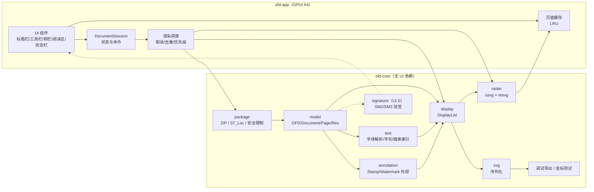

# VofdReader 开发计划

> 说明：本文档保留为开发过程记录，里程碑和进度不代表当前功能状态；当前功能、构建方式和已知限制以 [README](../README.md) 和源代码为准。

> 轻量、原生、跨平台的 OFD 阅读器 · Rust + GPUI
>
> 依据：GB/T 33190-2016《电子文件存储与交换格式 版式文档》
> 版本：v0.2 设计稿 · 2026-11-03
> 状态：M1 解析完成；M2/M3 渲染首版完成；M4 GPUI Kit 阅读器已可运行（Linux 实机验证）

---

## 0. 摘要

VofdReader 是一款只做“阅读”的桌面端 OFD 阅读器。目标不是复刻 WPS/福昕的全部能力，而是把**打开快、翻页顺、字迹清、内存低**这四件事做到位，覆盖电子发票、公文、证照、合同等最常见的 OFD 使用场景。

技术路线：

- **Rust** 负责容器解析、XML 建模、版面计算、字体处理与光栅化；
- **GPUI** 负责窗口、输入、滚动、缩放、侧栏与主题；
- **显示列表（DisplayList）** 作为解析与渲染之间的稳定中间层；
- v0.1 用 **DisplayList → SVG → resvg** 做像素级渲染，保证首版兼容性与可测试性；
- v0.3 增加 **GPUI 原生矢量渲染后端**，实现任意缩放下的锐利文字与文本选择；
- SVG 同时作为**调试产物、回归测试基准和设计原型的共同语言**。

首版范围刻意收窄：**不做编辑、不做签章验证、不做 PDF 导出、不做表单填写**。先把“读得对、读得快”打牢。

---

## 1. 目标与范围

### 1.1 目标用户与场景

| 场景 | 典型文件 | 关键诉求 |
| --- | --- | --- |
| 电子发票查验、报销 | 单页/多页发票，含二维码、印章、表格 | 秒开、缩放看清小字、印章完整 |
| 公文传阅 | 红头文件、通知、函，带版记与印章 | 版式还原、连续滚动、目录/页码 |
| 合同与标书 | 几十到几百页，含图片、表格 | 低内存、快速跳页、全文搜索 |
| 证照/回执 | 单页，含底纹、图像 | 色彩准确、打印友好 |

### 1.2 v0.1 功能（P0，必须）

- 打开：文件对话框、拖放、命令行参数、最近文件；
- 阅读：单页 / 连续滚动、上一页 / 下一页、跳页、Home/End；
- 缩放：25%–400%、适应宽度、适应页面、以鼠标位置为锚点缩放；
- 旋转：0°/90°/180°/270°；
- 缩略图侧栏：按需渲染、当前页高亮、点击跳转；
- 文档信息：页数、页面尺寸、OFD 版本、文件大小、创建者；
- **印章与注释外观**：StampAnnot / Watermark 外观流渲染（发票印章常以 Watermark 图片形式出现）；
- **签名材料检测**：检测 `Signs/` / `Signatures.xml`，显示“无签名 / 含签名（未验证）”；密码学验签后置到 v1.0（当前无签名样本）；
- 主题：跟随系统、亮色 / 暗色；
- 状态与错误：加载骨架、缺字体/缺资源的非致命提示、可读的错误面板；
- 快捷键：常用操作全覆盖；
- 单实例、无网络、无遥测。

### 1.3 v0.2 / v0.3（P1，首版后）

- 全文搜索、命中高亮、上一个/下一个、复制文本；
- 大纲 / 书签侧栏；
- 打印、导出当前页 PNG；
- 原生矢量渲染后端、文本选择；
- 多标签页、会话恢复；
- SM2/SM3 签名验证与证书详情（v1.0，待签名样本）。

### 1.4 明确不做（v1.0 前）

- OFD 编辑、合并、拆分；
- v0.1 不做 SM2/SM3 验签（签名样本缺失，后置到 v1.0）；
- 在线证书链校验、时间戳、OCSP/CRL 联网校验、OFD-A 存档合规校验；
- 表单填写、权限控制、加密文档；
- PDF/Office 转换、OCR、云同步。

### 1.5 “轻量”的量化标准

| 指标 | 目标 |
| --- | --- |
| 冷启动到首屏 | < 800 ms（10 页文档，SSD） |
| 首屏页面可读 | < 300 ms（解析 + 首帧低清） |
| 翻页（已缓存） | < 120 ms |
| 翻页（未缓存） | < 400 ms（A4 @ 100%） |
| 100 页文档内存 | < 200 MB |
| 安装包 / 二进制 | < 40 MB（不含可选 CJK 字体） |
| 空闲 CPU | ≈ 0%，无后台轮询 |
| 网络 | 完全离线 |

---

## 2. 标准与格式要点

> GB/T 33190-2016 全文约 126 页，对成像细节的描述比较克制，真实文件还存在厂商差异。下面的“标准语义”必须在 M1/M2 用样张逐条校准，不能只按文档实现。

### 2.1 容器

OFD 是一个 ZIP 包，入口固定为根目录的 `OFD.xml`：

```text
OFD.xml
Doc_0/
  Document.xml
  DocumentRes.xml
  PublicRes.xml
  Pages/
    Page_0/
      Content.xml
      Res/
        image_0.png
        font_0.ttf
  Annots/
  Signs/
  Tags/
  Attachments/
```

实现要点：

- ZIP 支持 Store / Deflate；拒绝加密条目；限制条目数、单条目大小、解压后总大小与压缩比（防 ZIP 炸弹）；
- `ST_Loc` 是以包根为基准的相对路径，支持 `.`、`..`；先精确匹配，再回退大小写不敏感匹配；规范化后必须仍在包内（防路径穿越）；
- 部分真实文件把内容包在一层目录下，或大小写不一致：入口缺失时回退查找 `*/OFD.xml`，路径查找失败时做一次大小写不敏感匹配并记录 warning；
- XML 命名空间优先 `http://www.ofdspec.org/2016`，兼容旧版 `http://www.ofdspec.org`；按 local-name 匹配，忽略未知元素/属性；
- v0.1 XML 按 UTF-8 解析（含 BOM）；GB18030 文件在 M2 用 `encoding_rs` 按 XML 声明转码后再解析，错误信息会明确区分编码问题。

### 2.2 文档树

```text
OFD.xml
└─ DocBody (可多个)
   ├─ DocInfo（Title/Author/CreationDate/...）
   ├─ DocRoot → Doc_0/Document.xml
   └─ Signatures → Signs/Signatures.xml（v0.3）
Document.xml
├─ CommonData（MaxUnitID、PageArea/PhysicalBox、PublicRes、DocumentRes、DefaultCS）
├─ Pages
│  ├─ Page ID / BaseLoc → Pages/Page_0/Content.xml
│  └─ TemplatePage → 模板页
└─ Annotations / Outlines / ...
Content.xml
└─ Page → Area（PhysicalBox）→ Content → Layer → PageBlock
   ├─ TextObject
   ├─ PathObject
   ├─ ImageObject
   ├─ CompositeObject
   └─ PageBlock（递归）
```

- 页面尺寸以 `PhysicalBox` 为准（单位 mm），页面可旋转；
- `PageRes` / `DocumentRes` / `PublicRes` 三级资源解析：`ResourceID="refID type"`，type `0` = 公有资源，`1` = 文档资源，`2` = 页面资源；真实文件也存在无类型写法（如 `ResourceID="6920"`），按 Page → Document → Public 的顺序查找；
- 模板页（`Template` + `ZOrder="Background|Foreground"`）在公文和发票中常见，v0.1 必须支持背景模板；
- 一个包可含多个 `DocBody`，v0.1 只打开第一个并在信息栏提示。

### 2.3 坐标系与单位

- OFD 的长度单位是**毫米**，坐标原点在页面左上角，**Y 轴向下**；
- 屏幕换算：`px = mm × (96 / 25.4) × zoom × device_scale`；
- 每个页面对象有 `Boundary="x y w h"`（对象外接矩形）与可选 `CTM="a b c d e f"`；
- 对象内部的路径/文字坐标通常以 Boundary 左上角为局部原点，再经 CTM 映射到页面；
- **M1 第一优先级校准项**：`Boundary + CTM + 局部坐标` 的组合顺序、`TextCode.X/Y` 的基线语义、`DeltaX/DeltaY` 的推进规则。标准描述较简，必须用多厂商样张做像素对照，不能凭直觉；
- 图像对象常见 `CTM="20 0 0 20 0 0"` + `Boundary="6.5 6 20 20"`：CTM 很可能负责把单位图像缩放到 30/20 mm，**不要把 CTM 缩放和 Boundary 尺寸重复相乘**；
- 文本水印常见 `CTM="0 1 -1 0 3.3084 0"` 做 90° 旋转；旋转中心与 Boundary 原点的关系需要样张校准；
- 上述假设与校准清单见 `docs/coordinates.md`。
- 旋转、翻转等页面级变换在视口层完成，不修改页面内容坐标。

### 2.4 图形对象 PathObject

```xml
<ofd:PathObject ID="6" Boundary="4.37 17.56 201.27 106.26"
                Fill="true" Rule="Even-Odd" Stroke="true"
                LineWidth="0.25" Cap="Butt" Join="Miter" MiterLimit="3.5">
  <ofd:FillColor Value="219 241 245"/>
  <ofd:StrokeColor Value="156 82 34" Alpha="255"/>
  <ofd:AbbreviatedData>M 171.1464 34.1293 L 171.1464 78.1348 C</ofd:AbbreviatedData>
</ofd:PathObject>
```

`AbbreviatedData` 是 OFD 自己的紧缩路径语法，不是 SVG path：

| 操作符 | 操作数 | 含义 |
| --- | --- | --- |
| `S` | `x y` | 定义子路径起点 |
| `M` | `x y` | 移动到指定点 |
| `L` | `x y` | 直线到指定点 |
| `Q` | `x1 y1 x2 y2` | 二次贝塞尔曲线 |
| `B` | `x1 y1 x2 y2 x3 y3` | 三次贝塞尔曲线 |
| `A` | `rx ry angle large sweep x y` | 椭圆弧到指定点（注意角度与大弧/优弧标志） |
| `C` | 无 | 闭合当前子路径（与 SVG 的 Z 不同） |

实现要点：

- 先解析为 `Vec<PathCmd>`，再转换为 SVG / tiny-skia / GPUI 路径，避免字符串直拼；
- 填充规则 `NonZero` / `Even-Odd`（标准原文有拼写 `NonZcro`，需容错）；
- 描边：`LineWidth`（mm）、`Cap`、`Join`、`MiterLimit`、`DashPattern`；
- 颜色支持 `"R G B"` 数组与 `#RRGGBB`，`Alpha` 0–255；v0.1 只做 sRGB，忽略 ICC；
- 缺省值按标准处理，并对厂商异常值做 clamp（负线宽、NaN、超大坐标）。

### 2.5 文字对象 TextObject

```xml
<ofd:TextObject ID="20" Boundary="29.5 25.5 76.5 8"
                Font="8" Size="4.2" Weight="400" Italic="false" HScale="100">
  <ofd:FillColor Value="0 0 0"/>
  <ofd:TextCode X="0" Y="3.6" DeltaX="g 0.2 0">国家税务总局</ofd:TextCode>
</ofd:TextObject>
```

- `Font` 是资源引用，按 PageRes → DocumentRes → PublicRes 顺序解析；资源里给出 `FontName`、`FamilyName`、`Bold`、`Italic`、`Serif`、`FontFile`；
- `CompositeObject` 通过 `ResourceID` 引用 `CompositeGraphicUnit`；资源可内联在 `DocumentRes.xml`/`PublicRes.xml`，也可用 `BaseLoc` 指向外部 XML；渲染时解析单元内容并按对象的 `Boundary`、`CTM`、`Alpha` 组合，组透明度作用到内部所有对象；
- 内嵌字体优先按字形轮廓绘制；没有内嵌字体时按名称映射到系统字体（宋体 / 黑体 / 楷体 / 仿宋 / 微软雅黑等）；
- `Size` 单位 mm；`TextCode.X/Y` 是局部坐标，`Y` 通常为基线；`DeltaX/DeltaY` 控制逐字推进，`g N X` 表示后续 N 个字符重复偏移 X；
- `CharDirection`（0/90/180/270）与 `ReadDirection`（LTR/RTL/竖排）必须支持；
- `HScale` 横向缩放、`Weight`、`Italic` 作为字体选择与合成的输入；
- **`CGTransform` / `Glyphs`**：真实发票样张中 26 个文字对象全部带此映射，用字形 ID 指定如何从子集字体取字。优先使用有效的字形簇，支持合字/展开及部分映射，否则查询 Unicode cmap；裸 CFF 按 charset 处理 CID。屏幕与导出都递归输出内嵌轮廓，逐字/逐簇回退。实现及验证边界见 [字体核验](FONTS.md)；
- 文本要同时产出**可搜索的字符 + 字形包围盒**，供搜索、复制与选择使用；
- 字体缺失时用最接近的 CJK 回退字体，并在状态栏提示“2 处字体已替换”。

### 2.6 图像对象 ImageObject

```xml
<ofd:ImageObject ID="30" ResourceID="2 0" Boundary="20 40 80 60" CTM="1 0 0 1 0 0"/>
<ofd:MultiMedia ID="0" Type="Image" Format="PNG">
  <ofd:MediaFile>Res/image_0.png</ofd:MediaFile>
</ofd:MultiMedia>
```

- 按 `ResourceID` 找到 `MultiMedia`，读取 `MediaFile`；
- v0.1 支持 PNG / JPEG / BMP / TIFF（`image` crate），JBIG2 / JPEG2000 显示占位并提示；
- 图像受 `Boundary`、`CTM`、`Clips` 约束；注意 `ImageMask` 与透明通道；
- 解码结果按内容哈希缓存，避免同一图片在多页重复解码。

### 2.7 注释、印章与签名

- 印章/水印通常不在页面正文里，而在注释外观流中：`Annotations.xml` → `PageAnnot` → `Annot` → `Appearance`，外观内部仍是 `TextObject` / `ImageObject` / `PathObject`；
- 用户提供的真实发票样本中，红色发票监制章就是一个 `Type="Watermark"` 的 `ImageObject`，另有一个旋转 90° 的文字水印。因此**注释外观渲染属于 v0.1 必做项**，不能留到后续；
- 渲染顺序：模板背景 → 页面内容 → 注释外观（按 `ZOrder`/`NoRotate` 处理）；
- **签名材料检测 + 印章外观**：检查 `Signs/` 与 `Signatures.xml`，状态栏显示 `无签名` 或 `含签名（未验证）`；提前解析 `Signature.xml → Seal.esl → StampAnnot`，按页面、位置和裁剪区域渲染印章外观，仍不做密码学验证；
- **验签后置到 v1.0**：签名结构为 `Signatures.xml` → `Signature` → `SignedInfo` / `SignedValue` / `References`；引用项用 SM3 计算摘要，签名值用 SM2 验证，并校验证书有效期与签名覆盖范围；
- v1.0 的验签为**离线验签**，不联网做 OCSP/CRL/时间戳；状态扩展为 `签名有效` / `签名无效` / `无法验证`；
- 验签失败或证书过期不阻止阅读，但必须在状态栏持续可见，不能只弹一次 toast。

> 当前样本没有 `Signs/` 目录，属于未签名文件；目前也没有可用的已签名样本，因此验签整体后移。v0.1 只保证“印章显示正确”和“签名状态不误导”。

### 2.8 兼容性策略

- **宽容解析**：未知元素跳过、缺失资源降级、数值解析失败用默认值并记录 warning；
- **严格安全**：路径穿越、ZIP 炸弹、XML DTD/实体、超大图像、递归 PageBlock 深度限制；
- **可观测**：`--log` 输出解析 warning；UI 聚合展示非致命问题；
- **厂商样本库**：数科、福昕、WPS、金山、ofdrw 生成的样本都要进回归集。

---

## 3. 技术选型

| 领域 | 选择 | 理由 | 备选 |
| --- | --- | --- | --- |
| 语言 | Rust 2024 edition，稳定版工具链 | 内存安全、单二进制、跨平台 | — |
| UI | GPUI Kit 0.9（GPUI 0.3.11 + Component 组件库） | GPU 渲染、原生输入、现成按钮/主题/根布局，无 WebView | 裸 GPUI、egui、Slint |
| ZIP | `zip`（deflate） | 成熟、支持 Store/Deflate | `rc-zip` |
| XML | `roxmltree` | 零拷贝只读 DOM、按 local-name 匹配、无 DTD 展开风险；单页 XML 体量可控 | `quick-xml`（超大页面时替换） |
| 光栅 | `resvg` + `usvg` + `tiny-skia` | 高质量 SVG 渲染、字体/裁剪/透明度完备 | 自绘 + lyon |
| 字体 | `fontdb`（系统字体）+ `ttf_parser`（内嵌轮廓）+ 系统 CJK 回退 | 内嵌字体字形精确、同名子集不串味 | `cosmic-text` |
| 图像 | `image`（png/jpeg/bmp/tiff） | 覆盖常见 OFD 图像 | `zune-image` |
| 错误 | `thiserror` | 轻量、可组合 | `anyhow`（仅 CLI） |
| 日志 | `tracing` + `tracing-subscriber` | 结构化、按需开启 | `log` |
| 文件对话框 | `rfd` | 原生对话框 | GPUI 自带（不完整） |
| 签名（v1.0） | `sm2` + `sm3` + `x509-parser` + `der`/`base64` | 样本到位后做离线 SM2/SM3 验签 | OpenSSL（重、跨平台打包麻烦） |
| 配置 | `serde` + `serde_json` + `directories` | 最近文件、主题、会话 | TOML |
| CLI | `clap` | 调试/CI 工具链 | 手写 |

### 3.1 为什么不用现成的 `ofd-core` crate

社区已有 `ofd-core`（0.3.x）等 Rust 实现，可作为**交叉验证参考**，但首版仍自研核心：

- 需要完全控制错误恢复、字体回退与显示列表，才能达到“轻量 + 高兼容”的目标；
- 第三方 crate 的 API 与渲染假设不一定匹配 GPUI 的缓存/线程模型；
- 解析器本身是本项目最可控、最值得投入的部分，体量并不大。

### 3.2 GPUI Kit 版本策略

项目统一通过 **`gpui-kit = "=0.9.0"`** 使用 GPUI（它绑定 `gpui-pre 0.3.11`），不再直接写 `gpui`/`gpui_platform` 依赖：

1. `use gpui_kit::*;` 即 GPUI；`gpui_kit::component::*` 提供 Button、Input、Sidebar 等组件；
2. 应用入口用 `gpui_kit::application()` + `gpui_kit::init(cx)` + `gpui_kit::open_window(...)`；
3. 锁定 `=` 版本并提交 `Cargo.lock`；UI 调用集中在 `ofd-app`，升级只改这一层；
4. 已用 Linux 实机跑通：打开真实发票、翻页、缩放、适应页面、页面图像显示；
5. 三平台 CI 已配置，macOS/Windows 需在 M4 完成前实机验证。

---

## 4. 架构设计

### 4.1 总览



### 4.2 Crate 划分

```text
ofd-reader/
├── Cargo.toml                # workspace
├── crates/
│   ├── ofd-core/             # 纯逻辑，可 headless 测试
│   │   ├── package.rs        # ZipPackage、路径规范化、安全限制
│   │   ├── model/            # OFD.xml / Document / Page / Resource / Annotation
│   │   ├── display/          # DisplayList 与 Path/Text/Image 图元
│   │   ├── annotation.rs     # StampAnnot / Watermark 外观流
│   │   ├── signature/        # v1.0：Signatures.xml、SM2/SM3（后置）
│   │   ├── text/             # 字体注册、字体名映射、字形布局
│   │   ├── svg.rs            # DisplayList → SVG（mm 坐标系）
│   │   ├── raster.rs         # SVG → usvg::Tree → resvg 像素
│   │   ├── search.rs         # v0.2 文本索引
│   │   └── error.rs
│   ├── ofd-cli/              # info / pages / text / check / render
│   └── ofd-app/              # GPUI Kit 桌面端
│       ├── main.rs
│       ├── state.rs          # DocumentSession、ViewState、Recent
│       ├── worker.rs         # 后台解析/渲染、取消、结果合并
│       └── ui/               # titlebar/toolbar/sidebar/viewer/statusbar
├── assets/                   # 图标；可选回退字体
├── fixtures/                 # 手工最小样本 + 本地真实样本（不入库）
└── docs/
```

依赖方向：`ofd-app → ofd-core`，`ofd-cli → ofd-core`，**core 不依赖 GPUI**。这样 CLI 与金标测试可以在没有图形环境时跑通，CI 也更稳。

### 4.3 关键类型（草案）

```rust
// 单位：mm；坐标系：页面左上角，Y 向下
pub struct SizeMm { pub w: f64, pub h: f64 }
pub struct RectMm { pub x: f64, pub y: f64, pub w: f64, pub h: f64 }
pub struct Matrix(pub [f64; 6]); // a b c d e f

pub enum PageItem {
    Path {
        cmds: Vec<PathCmd>,
        fill: Option<Color>,
        stroke: Option<StrokeStyle>,
        rule: FillRule,
        ctm: Matrix,
        clips: Vec<Clip>,
    },
    Text {
        glyphs: Vec<PositionedGlyph>, // 字符 + 局部坐标 + 字体
        style: TextStyle,
        ctm: Matrix,
        clips: Vec<Clip>,
    },
    Image {
        res: ResId,
        rect: RectMm,
        ctm: Matrix,
        clips: Vec<Clip>,
    },
}

pub struct DisplayList {
    pub page: SizeMm,
    pub items: Vec<PageItem>,
    pub text: Vec<TextSpan>, // 供搜索/复制
    pub warnings: Vec<Warning>,
}

pub struct OfdDocument { /* ... */ }

impl OfdDocument {
    pub fn open(path: impl AsRef<Path>) -> Result<Self>;
    pub fn page_count(&self) -> usize;
    pub fn page_size(&self, index: usize) -> Result<SizeMm>;
    pub fn display_list(&self, index: usize) -> Result<DisplayList>;
    pub fn to_svg(&self, index: usize) -> Result<String>;
}

pub struct RenderOptions {
    pub scale: f64,        // mm → px 的总倍率
    pub rotation: Rotation,
    pub background: Color,
}

pub fn rasterize(list: &DisplayList, assets: &AssetStore, opts: &RenderOptions)
    -> Result<RgbaImage>;
```

### 4.4 渲染管线（v0.1）

```text
Content.xml ──parse──► PageModel
                         │ resolve resources / fonts / images
                         ▼
                    DisplayList ──serialize──► SVG（viewBox 单位 mm）
                         │                          │
                         │                          ├─► 调试导出 (*.svg)
                         │                          └─► usvg::Tree（每页缓存一次）
                         │                                   │
                         │                                   └─ resvg::render(scale) ─► RgbaImage
                         ▼
                 文本索引（搜索/复制，v0.2）
```

关键点：

- **SVG 以毫米为单位**，`viewBox="0 0 210 297"`，渲染时只改变换矩阵。这样同一棵 `usvg::Tree` 可以在任意缩放下光栅化，缩放不需要重新排版；
- 每页的 `usvg::Tree` 缓存一次，缩略图与主视图共用；
- 系统字体文字在 SVG 中用 `<text>` + `x="x1 x2 ..."` 做逐字定位；内嵌字体文字按 Unicode cmap 或 `CGTransform` 字形 ID 转成 `<path>`，复杂竖排/旋转按字加 `transform`；
- 系统字体由 `fontdb` 统一加载；内嵌字体不注册到 `fontdb`，而是直接从字体文件取轮廓，避免同名家族覆盖；
- 裁剪、透明度、虚线、奇偶填充交给 resvg；
- 渲染时 `usvg` 把 mm 换算为 px（96 DPI），`resvg` 再按 `dpi/96` 缩放；PNG 输出已验证；
- 当前 app 直接显示 BGRA `RenderImage`，不经过临时 PNG；内部渲染 SVG 跳过 `@font-face`，系统字体把同一对象、同一基线的字符合并为 `<text x="x1 x2 …">`，内嵌字体输出 `<path>`。

### 4.5 线程与缓存

- 主线程只做 UI 与绘制；页面光栅化与缩略图在 GPUI 后台执行器；
- 已实现：请求序号 + “最新请求/当前页/不降级”才可替换画面，过期结果只进缓存；相同 `(page, dpi)` 请求合并；文档代际号丢弃旧文档结果；
- 页面位图为 128 MiB / 最多 8 张的字节预算 LRU，命中更新顺序，当前显示页不会被立即逐出；同页有更高 DPI 缓存时直接复用；
- 解压后的 XML 条目有 16 MiB LRU，页面/模板/注释复用；`usvg::Tree` 缓存 4 页；系统字体库进程内共享；
- 打开文档只同步解析第一页尺寸，其余在后台用 `page_size_only()` 补齐；
- 缩略图串行生成，并在主页面显示后开始，从当前页向两侧扩展；
- 150 ms 真正防抖（代际号），只在提高清晰度时触发；缩小时复用已有位图；
- 已实现单页/连续视图、滚轮滚动，以及键盘翻页/缩放（方向键、J/K、PageUp/PageDown、Space、Home/End、+/-/0）；
- 内存预算：位图 128 MiB + XML 16 MiB，均为近似上限。

### 4.6 高倍缩放的取舍

A4 在 200% + 2x 屏下，单页像素约 3176×4492 ≈ 14.3 M 像素、57 MB。整页缓存无法承受 400%。

当前策略：

- 页面渲染 DPI 按 `96 × 窗口缩放 × fit × zoom` 计算，量化到 24 DPI 档并限制在 `96–384`；HiDPI（1.75×/2×）下与设备像素 1:1，避免位图放大发虚；
- 缩略图固定 48 DPI；缩放或窗口尺寸改变后后台重新光栅化，缓存按 `(page, dpi)` 复用；
- 超过 300% 仍是位图放大（略糊），状态栏如实显示缩放；
- v0.3 用 GPUI 原生矢量 + 字形绘制解决高倍清晰度；必要时再加可视区域分块光栅。

---

## 5. 字体与文字

### 5.1 字体解析顺序

1. 页面资源 `PageRes` 中的字体；
2. 文档资源 `DocumentRes`；
3. 公有资源 `PublicRes`；
4. 内嵌 `FontFile`（TTF/OTF；轮廓由 `ttf_parser` 读取）；
5. 系统字体按名称/别名匹配；
6. 最终回退到系统 CJK 字体（无衬线），并提示替换。

### 5.2 常见字体名映射

| OFD 中常见名称 | 优先系统字体 |
| --- | --- |
| 宋体 / SimSun / Song | Source Han Serif CN、Noto Serif CJK SC、SimSun |
| 黑体 / SimHei / Hei | Source Han Sans CN、Noto Sans CJK SC、SimHei |
| 楷体 / KaiTi | KaiTi、Kaiti SC、STKaiti |
| 仿宋 / FangSong | FangSong、STFangsong |
| 微软雅黑 / Microsoft YaHei | Microsoft YaHei、Noto Sans CJK SC |
| Times New Roman / Arial | 系统同名，找不到则 DejaVu/Liberation |

不默认打包 CJK 字体（体积 10–20 MB）。Linux 无中文字体时给出明确提示；可作为可选安装包。

### 5.3 文字渲染的验收

- 用包含中英混排、标点挤压、上下标、竖排、旋转、`DeltaX` 的样张；
- 与 ofdrw / 参考阅读器的截图做叠加对比，逐字检查基线、字距、换行；
- 文本提取结果与页面文字逐字一致；
- 缺字体时不能崩溃、不能整页空白。

---

## 6. UI / UX 设计

### 6.1 原型

| 界面 | 文件 | 说明 |
| --- | --- | --- |
| 亮色主界面 | `docs/prototype/01-main-light.svg` | 缩略图侧栏、A4 页面、浮动缩放条、文档信息 |
| 暗色搜索 | `docs/prototype/02-search-dark.svg` | 收起侧栏、搜索浮条、命中高亮、结果面板 |

> PNG 预览在 `docs/prototype/preview/`，可用浏览器直接打开 SVG 查看矢量版。

### 6.2 布局

```text
┌────────────────────────────────────────────────────────────┐
│ 标题栏 44px：应用 / 文件名 / 页数 / 窗口控制                 │
├────────────────────────────────────────────────────────────┤
│ 工具栏 52px：打开 · 侧栏 · 搜索 · … · 打印 · 导出 · 主题     │
├──────────┬─────────────────────────────────────────────────┤
│ 侧栏     │ 阅读区                                          │
│ 240px    │ 页面居中 + 阴影 + 点阵底纹                       │
│ 缩略图   │                                                 │
│ 目录     │              浮动缩放条                         │
│ 书签     │                                                 │
│ 文档信息 │                                                 │
├──────────┴─────────────────────────────────────────────────┤
│ 状态栏 28px：页码 · 纸张 · 缩放 · 版本 · 签名状态            │
└────────────────────────────────────────────────────────────┘
```

- 最小窗口 960×640；默认 1280×860；
- 已实现：44px 自绘标题栏、52px 工具栏、240px 侧栏、浮动缩放条、28px 状态栏；
- 侧栏可在工具栏折叠；缩略图为单列全宽并按页面宽高比缩放；文档信息不再常驻侧栏，改为工具栏“更多”菜单中的模态窗口；
- 图标统一使用 gpui-kit 内置 Lucide；仅嵌入应用使用的 24 个图标，并合并组件默认图标，避免 `AllAssets` 打包全量图标；工具栏/缩放条/状态栏已替换；
- 阅读区已加入点阵底纹与页面阴影，整体与 SVG 原型对齐；浮动缩放条在指针静止 2.5 秒后自动隐藏，移动时重新出现；
- 浮动缩放条全部控件可用：缩放、适应宽度/页面、顺时针 90° 旋转（同步位图、搜索高亮、选择与分块坐标）、页面缩略图网格总览；
- 亮暗主题可即时切换（自绘调色板 + gpui-kit 组件主题），暗色值取自 `docs/prototype/02-search-dark.svg`；
- 搜索浮条检索页面正文 + 背景模板文字，结果按页列出，支持 Enter/Shift+Enter/点击跳转与 Esc 关闭；当前页命中以黄色半透明矩形叠加显示，旋转文字使用包围盒；
- 页面文本布局支持拖选与复制：选择按显示列表阅读顺序，蓝色高亮；Ctrl/Cmd+C 复制并按视觉行/文本对象拼接；注释组不参与选择；
- 页面显示改为 `DisplayList → usvg → tiny-skia` 直接输出 BGRA `RenderImage`，不再写临时 PNG；解析后的 `usvg::Tree` 按页缓存 4 份，系统字体库进程内复用，缩略图在主页面完成后串行生成；
- 导出菜单未接入，改为保存对话框直出当前页：`.svg` 扩展名导出矢量，其余导出 144 DPI PNG；状态栏显示进度和结果；
- 主窗口参照 Zed 实际 `client_side_decorations`：5px 外圆角、10px inset、居中黑色 40% / blur 5px 单层阴影；仅由组件层绘制一套装饰，Root 透明，顶部/底部显式绘制内圆角；平铺贴边取消圆角和边框，全屏取消客户端装饰；详见 `docs/WINDOW_DECORATIONS.md`；
- 页面阴影克制，避免“卡片化”盖过内容。

### 6.3 设计令牌

| 令牌 | 亮色 | 暗色 |
| --- | --- | --- |
| `bg.window` | `#F7F8FA` | `#17191E` |
| `bg.toolbar` | `#FFFFFF` | `#1A1D23` |
| `bg.surface` | `#FFFFFF` | `#1C1F26` |
| `bg.sidebar` | `#F6F7F9` | `#17191E` |
| `bg.canvas` | `#E9EBEF` | `#0F1217` |
| `border` | `#E5E7EB` | `#262A31` |
| `text` | `#1B1E25` | `#E7EAF0` |
| `text.secondary` | `#5B6472` | `#A7B0BF` |
| `accent` | `#2F6FEB` | `#3B76F0` |
| `border` | `#E5E7EB` | `#262A31` |
| `text.primary` | `#1B1E25` | `#E7EAF0` |
| `text.secondary` | `#5B6472` | `#A7B0BF` |
| `text.tertiary` | `#98A1AF` | `#6F7A8B` |
| `accent` | `#2F6FEB` | `#6C9CFF` |
| `highlight` | `#FFD54A` | `#FFD54A` |
| `seal` | `#C8102E` | `#C8102E` |
| `success` | `#15803D` | `#4ADE80` |
| `danger` | `#B91C1C` | `#F87171` |
| `warning` | `#B45309` | `#FBBF24` |

字体：UI 使用思源黑体/系统无衬线；文档内容保留 OFD 指定字体。字号：标题 13、正文 12、辅助 10.5–11、文档内容按 mm 换算。

### 6.4 交互与快捷键

| 操作 | 快捷键 |
| --- | --- |
| 打开 | `Ctrl/Cmd+O` |
| 关闭/返回 | `Esc` |
| 上一页 / 下一页 | `PageUp` / `PageDown`，`↑` / `↓`（单页模式） |
| 首页 / 末页 | `Home` / `End` |
| 放大 / 缩小 | `Ctrl/Cmd + =` / `Ctrl/Cmd + -` |
| 适应宽度 / 适应页面 | `Ctrl/Cmd+1` / `Ctrl/Cmd+0` |
| 实际大小 100% | `Ctrl/Cmd+2` |
| 旋转 | `R` |
| 搜索 | `Ctrl/Cmd+F` |
| 侧栏 | `Ctrl/Cmd+B` |
| 缩放锚点 | `Ctrl/Cmd + 滚轮` |
| 平移 | `Space + 拖拽`，或中键拖拽 |
| 全屏 | `F11` / `Ctrl+Cmd+F` |

状态设计：空状态（拖放提示 + 最近文件）、加载骨架、部分降级（黄色提示条）、错误面板（错误码 + 建议 + 复制详情）、搜索无结果。

### 6.5 印章与签名状态

- 印章/水印按注释外观流渲染，和正文同一缩放、同一旋转；印章不能因为“只是图片”被省略；
- 签名文档会读取 `Seal.esl` 中内嵌的 PNG/JPEG，并按 `StampAnnot` 的 `PageRef`、`Boundary`、`Clip` 叠加印章；跨页印章切片按裁剪矩形显示；
- 状态栏只显示两种签名状态：`无签名`（灰）、`含签名（未验证）`（黄）；**不显示“签名有效”**，避免在没有验签能力时误导用户；
- v1.0 接入 SM2/SM3 后扩展为四态：`无签名` / `签名有效` / `签名无效` / `无法验证`，点击打开详情（签名者、证书、有效期、引用摘要）；
- 验签失败或证书过期时，继续允许阅读，但状态栏持续警示。

---

## 7. 里程碑与排期

按 1 人全职、约 6 周设计；若是业余时间（每天 2–3 小时），约 10–12 周。

| 阶段 | 内容 | 交付物 | 人日 | 验收 |
| --- | --- | --- | --- | --- |
| **M0** 准备 | workspace、CI、GPUI hello world（三平台）、样张收集、锁定 rev | 可构建骨架、样本清单 | 1 | 三平台窗口能开 |
| **M1** 容器与模型 | ZIP/ST_Loc、OFD/Document/Pages/Res、字体与图像资源、CLI `info/pages/text` | `ofd-cli` 可读真实样本 | 5 | 解析成功率 100%，错误可控 |
| **M2** 显示列表 | Path/Text/Image、CTM/Clips、模板页、CGTransform、注释外观、SVG 导出 | `ofd-cli render --svg` | 6 | 路径/文字/印章基本还原 |
| **M3** 光栅化 | usvg 缓存、resvg、内嵌字体、缩放桶、金标测试 | `ofd-cli render --png` | 4 | A4@2x < 80 ms，无缺字 |
| **M4** GPUI 阅读器 | 打开/拖放、布局、连续滚动、缩放/旋转、缩略图、主题、快捷键 | 可日常使用的阅读器 | 6 | 10 页文档流畅阅读 |
| **M5** 搜索与文本 | 文本提取、查找、命中高亮、复制、目录/书签 | 搜索能力 | 4 | 搜索准确率 ≥ 95% |
| **M6** 打包打磨 | 安装包、图标、错误页、日志、性能、文档 | 三平台发布包 | 3 | 冷启动/内存达标 |

总计约 **29 人日**（不含 20% buffer）。关键路径：M1 → M2 → M3 → M4；M5 可在 M4 后期并行。

当前进度：M0 完成；M1 完成；M2/M3 首版完成（真实发票 SVG/PNG 已核对）；M4 首版可在 Linux 打开、拖放、从最近文件打开、翻页、缩放、适应页面，并有缩略图侧栏、后台渲染、按设备像素密度光栅化、搜索、导出、亮暗主题和持久化设置窗口；`resources/` 语料 40 个 OFD、118 页全部可渲染；剩余 M4 工作为三平台实机验证。

### 7.1 每周节奏建议

- 周一：明确本周验收样本与失败用例；
- 周三：跑一次全量样本回归，记录像素差异；
- 周五：打包一个可运行的内部版本，更新 `CHANGELOG`；
- 每完成一个里程碑：冻结一次 `Cargo.lock`，打 tag。

---

## 8. 测试与质量

### 8.1 测试矩阵

| 层级 | 内容 | 工具 |
| --- | --- | --- |
| 单元测试 | ST_Loc、ST_Box、颜色、矩阵、DeltaX、路径操作符 | `cargo test` |
| 解析回归 | 20–50 个真实/构造样本；统计 warning 与失败原因 | fixture + snapshot |
| 渲染回归 | 每页导出 PNG，与基准图做像素差/SSIM | `image` + 自定义 diff |
| SVG 快照 | DisplayList 序列化结果稳定 | `insta` |
| 模糊测试 | XML、AbbreviatedData、ZIP 条目 | `cargo-fuzz` |
| 性能 | 解析、SVG 构建、1x/2x 光栅、内存 | `criterion` + `heaptrack` |
| 手工验收 | 三平台、HiDPI、深浅色、缩放极值 | checklist |

### 8.2 样本库

至少覆盖：

1. 单页电子发票（PNG 印章、二维码、表格）；
2. 多页红头公文（模板页、仿宋、版记、骑缝章）；
3. 带内嵌字体的合同（宋体/黑体/楷体）；
4. 含 JPEG 大图与透明 PNG 的标书；
5. 旋转页面、竖排文字、`CharDirection` 非 0；
6. 缺字体、缺图片、路径穿越、超大坐标等异常样本；
7. 数科 / 福昕 / WPS / ofdrw 各至少 1 个，观察厂商差异。

当前已有一个真实电子发票样本（已放入 `fixtures/private/`；文件含真实信息，已从版本库排除）。它在 M1 阶段提供的关键信号：

| 观察 | 影响 |
| --- | --- |
| 页面 210×140 mm，单页 | UI 必须支持可变纸张尺寸，不能假设 A4 |
| 使用背景模板页（`Tpls/Tpl_0`） | 模板渲染进 v0.1 |
| 26 个文字对象全部带 `CGTransform` | 必须处理字形 ID 映射，不能只按 Unicode 渲染 |
| 3 个内嵌子集字体 + 2 个系统回退字体 | 字体注册、子集 cmap、回退提示都要做 |
| 红色发票监制章是 `Watermark` 注释里的 `ImageObject` | 注释外观渲染进 v0.1 |
| `ResourceID="6920"` 不含类型位 | 资源解析要支持无类型 ID 的跨作用域回退 |
| 无 `Signs/` 目录 | 当前样本未签名；v0.1 只做材料检测，验签后置 v1.0 |

> 真实样本请脱敏后放入 `fixtures/`，不要提交含个人信息的文件。签名样本暂缺，验签推迟到 v1.0；当前优先保证印章显示与版面还原。

### 8.3 安全底线

- 拒绝绝对路径与 `..` 越界；
- 限制 ZIP 条目数（≤ 10,000）、单条目（≤ 200 MB）、总解压（≤ 1 GB）、压缩比（≤ 200:1）；
- XML 不处理 DTD/外部实体；PageBlock 递归深度 ≤ 64；
- 图像解码限制最大像素（≤ 100 MP）；
- 不访问网络、不执行脚本、不加载外部资源。

---

## 9. 打包与发布

| 平台 | 形式 | 说明 |
| --- | --- | --- |
| Windows | 绿色版 exe + MSI | 无需 WebView；图标与文件关联 |
| macOS | `.app`（可选 universal） | 先不签名；后续 notarization |
| Linux | `.deb` + AppImage | 依赖 Vulkan/GBM/Wayland/X11/fontconfig；文档列明 |

- `--release` 开启 LTO、strip、`panic=abort`（CLI 保留 unwind 以便定位）；
- 版本号从 `0.1.0` 开始；`--version` 输出 git rev 与 GPUI rev；
- 崩溃日志写用户配置目录，不上传；
- **许可证：GPL-3.0-or-later**。发布二进制时同时提供 `LICENSE`、第三方许可证汇总与完整对应源码的获取方式；
- 依赖兼容性：GPUI（Apache-2.0）、resvg（MPL-2.0）、Rust 生态常用 crate（MIT/Apache-2.0）均与 GPLv3 兼容。不建议 GPL-2.0-only，因为它与 Apache-2.0 的 GPUI 不兼容；
- 第三方许可证汇总（GPUI Apache-2.0、resvg MPL-2.0、字体 OFL 等）。

---

## 10. 风险与对策

| 风险 | 影响 | 概率 | 对策 |
| --- | --- | --- | --- |
| GPUI Kit / GPUI 版本变化 | 编译中断、返工 | 中 | 锁 `=0.9.0` 与 `Cargo.lock`；UI 集中在 ofd-app；升级前跑三平台 |
| Linux 图形栈差异 | 无法启动/黑屏 | 中 | 明确依赖；检测 Vulkan/GL；X11 回退；CI 覆盖 |
| 真实 OFD 厂商差异 | 页面错位/缺内容 | 高 | 宽容解析；样本库；warning 可观测；像素对照 |
| Boundary/CTM/文字基线语义偏差 | 整页错位 | 高 | M1 首要校准；多厂商样张；不与实现“猜” |
| 字体缺失/CFF/授权 | 文字模糊或空白 | 中 | 内嵌优先 + 系统回退 + 明确提示；不打包受限字体 |
| 高倍缩放内存 | OOM/卡顿 | 中 | 缩放桶 + 上限 + LRU；v0.3 原生矢量/分块 |
| ZIP/XML 恶意输入 | 安全漏洞 | 中 | 限额、无 DTD、fuzz、路径校验 |
| 功能蔓延（签章/编辑） | 首版延期 | 高 | 明确非目标；v0.2/v0.3 路线；feature gate |
| GPUI 文本系统限制 | 逐字定位/竖排困难 | 中 | v0.1 走 SVG 文本；原生后端单独攻关 |
| 签名样本缺失 | 验签无法验收 | 高 | 已决策：验签后置 v1.0；v0.1 只显示材料存在性，不冒充验证通过 |
| GPL 合规 | 发布/分发受阻 | 低 | 发布源码与 LICENSE；`cargo-deny` 审计；避免 GPL-2.0-only |

---

## 11. 后续路线

- **v0.1（可用阅读）**：打开/翻页/缩放/旋转、模板与印章/水印、签名材料状态、三平台安装包；
- **v0.2（阅读增强）**：全文搜索、复制、目录/书签、打印、PNG 导出；
- **v0.3（原生渲染）**：GPUI 直接绘制 Path/Text，任意缩放清晰、文本选择、分块光栅；
- **v1.0（可信阅读）**：OFD-A 一致性检查、在线证书链/时间戳、注释编辑、表单只读展示、多标签；
- **长期**：插件式渲染后端、Windows 预览处理器、命令行批量转换。

---

## 12. 当前进度与下一步

已完成（2026-11-04）：

- Cargo workspace：`ofd-core` + `ofd-cli` + `ofd-app`；
- ZIP 容器、`ST_Loc` 路径规范化、安全限额、大小写容错；
- `OFD.xml` / `Document.xml` / `Pages` / 资源 / 注释解析；
- `DisplayList`：Path / Text / Image / Group，模板页 + 正文 + 注释外观；
- SVG 导出（mm 坐标系、内嵌字形路径、系统回退文字逐字定位）；
- `usvg + resvg` 光栅化，内嵌 SFNT/CFF 轮廓、字体集合选面，PNG 输出；
- 真实发票验证：210×140 mm、26 文字 + 1 图形 + 1 图像、红色印章（Darken）与旋转水印位置正确；
- GPUI Kit 0.9 桌面端：自绘标题栏、原型布局、Lucide 图标、点阵底纹、缩略图侧栏、文档信息弹窗、浮动缩放条、状态栏、键盘快捷键；
- 后台渲染 + 按设备像素密度光栅化 + 请求序号/防抖 + 字节预算 LRU 页面缓存；
- 打开文档后台补齐页面尺寸；XML 解压缓存；内部渲染 SVG 精简；
- 全文搜索（正文 + 模板文字）、导出、亮暗主题、文档信息弹窗、浮动缩放条自动隐藏；
- 单元/集成测试（路径、矩阵、路径语法、最小 OFD 包、SVG 输出）；
- 原型、计划、坐标记录、GPL-3.0、三平台 CI。

下一步：

1. macOS / Windows 实机验证 GPUI Kit 窗口与字体（M4）；
3. M5：搜索页内高亮、文本选择/复制、目录/书签；
4. 打印与安装包；
5. 验签保持后置：只保留“含签名（未验证）”状态，等签名样本再启动 v1.0 工作。

---

## 附录 A：一个最小 OFD 的结构

```text
mini.ofd (zip)
├── OFD.xml
└── Doc_0/
    ├── Document.xml
    ├── PublicRes.xml        # 可选
    ├── DocumentRes.xml      # 可选
    ├── Pages/
    │   └── Page_0/
    │       ├── Content.xml
    │       └── Res/
    │           ├── font_0.ttf
    │           └── image_0.png
    └── Annots/
```

`OFD.xml`：

```xml
<?xml version="1.0" encoding="UTF-8"?>
<ofd:OFD xmlns:ofd="http://www.ofdspec.org/2016" Version="1.0" DocType="OFD">
  <ofd:DocBody>
    <ofd:DocInfo>
      <ofd:DocID>demo-0001</ofd:DocID>
      <ofd:Title>示例文档</ofd:Title>
    </ofd:DocInfo>
    <ofd:DocRoot>Doc_0/Document.xml</ofd:DocRoot>
  </ofd:DocBody>
</ofd:OFD>
```

`Content.xml`（节选）：

```xml
<ofd:Page xmlns:ofd="http://www.ofdspec.org/2016" ID="1">
  <ofd:Area>
    <ofd:PhysicalBox>0 0 210 297</ofd:PhysicalBox>
  </ofd:Area>
  <ofd:Content>
    <ofd:Layer ID="2">
      <ofd:PathObject ID="3" Boundary="20 20 170 20" Fill="true" Stroke="false">
        <ofd:FillColor Value="235 240 248"/>
        <ofd:AbbreviatedData>M 0 0 L 170 0 L 170 20 L 0 20 C</ofd:AbbreviatedData>
      </ofd:PathObject>
      <ofd:TextObject ID="4" Boundary="24 26 160 10" Font="1" Size="5">
        <ofd:TextCode X="0" Y="5">VofdReader 示例</ofd:TextCode>
      </ofd:TextObject>
    </ofd:Layer>
  </ofd:Content>
</ofd:Page>
```

> 说明：上面的 XML 是**测试用最小样本**，不保证通过所有实现的严格校验；它的价值是覆盖文本、路径、资源、命名空间与单位换算。

---

## 附录 B：参考资料

- GB/T 33190-2016 标准信息页：<https://openstd.samr.gov.cn/bzgk/std/newGbInfo?hcno=3AF6682D939116B6F5EED53D01A9DB5D>
- OFD 基本结构（公开整理）：<https://www.hiofd.com/doc/ofd-base-struct>
- 图形对象与 AbbreviatedData 运算符（公开整理）：<http://wiki.easyofd.cn/OFD标准/图形>
- ofdrw（Java，OFD 读写，适合做交叉验证）：<https://github.com/Trisia/ofdrw>
- ofd.js（JS 渲染实现，可对照坐标/字体处理）：<https://github.com/DLTech21/ofd.js>
- resvg / usvg：<https://github.com/linebender/resvg>
- GPUI（Zed）：<https://github.com/zed-industries/zed>
- GPUI 文本系统与字体注册参考：<https://gpui-kit.com/docs/fonts>

---

## 附录 C：决策记录（ADR 摘要）

| 编号 | 决策 | 状态 |
| --- | --- | --- |
| D1 | 自研 `ofd-core`，现有 Rust 实现仅作参考 | 已定 |
| D2 | v0.1 采用 DisplayList → SVG → resvg，不自绘 | 已定 |
| D3 | SVG 使用 mm 坐标系，`usvg::Tree` 按页缓存 | 已定 |
| D4 | v0.1 使用客户端自绘标题栏（Linux Wayland 已验证） | 已定 |
| D5 | 默认连续滚动，可切换单页 | 已定 |
| D6 | 签名验证后置 v1.0（暂无签名样本），v0.1 仅检测材料 | 已定 |
| D7 | 不默认打包 CJK 字体 | 已定 |
| D8 | 许可证 GPL-3.0-or-later | 已定 |
| D9 | Windows / macOS / Linux 三平台同时支持 | 已定 |
| D10 | 印章/水印注释外观渲染进入 v0.1 | 已定 |
| D11 | UI 使用 GPUI Kit 0.9（`=0.9.0`，绑定 gpui-pre 0.3.11） | 已定 |
| D12 | 图标统一使用 gpui-kit 内置 Lucide 图标 | 已定 |
| D13 | 参照 Zed 工作区装饰：5px 圆角、10px inset、单层居中阴影；Linux 暂保留 Wayland / X11 | 已定 |
| D14 | 亮暗主题共用一套自绘调色板，组件主题随模式切换；暗色取原型 02 的令牌 | 已定 |
| D15 | 导出当前页：按保存扩展名选择 PNG（144 DPI）/ SVG，不弹额外菜单 | 已定 |
| D16 | 搜索覆盖正文与背景模板文字；结果按页跳转，当前页命中绘制高亮 | 已定 |
| D20 | 文本选择按页内阅读顺序，排除注释组；自动换行/空格由行与文本对象边界决定 | 已定 |
| D21 | 图案填充展开为 CellContent 平铺；字体/图片路径按实际包内大小写解析，`/` 视为包根 | 已定 |
| D22 | `DeltaX` 的 `g N X` 批量值展开，`DeltaY` 用于竖排逐字定位 | 已定 |
| D23 | 签名印章外观提前：解析 `Seal.esl` + `StampAnnot` 并渲染 `Clip` 切片；验签仍后置 | 已定 |
| D17 | 显示路径直接用 BGRA `RenderImage`；树缓存 + 字体库复用 + 缩略图串行 | 已定 |
| D18 | 渲染请求带序号，过期结果只进缓存；150 ms 代际防抖；图片缓存按字节预算 LRU | 已定 |
| D19 | 内部 SVG 跳过 `@font-face`，同对象同基线文本合并为一个 `<text>`；导出 SVG 保持自包含 | 已定 |

---

## 附录 D：已确认事项与仍需确认的问题

已确认：

1. 三平台同时支持：Windows / macOS / Linux；
2. 需要显示印章/签章外观；签名验证后置到 v1.0（用户确认目前没有签名样本）；
3. 已收到 1 个真实电子发票样本（未签名，页面 210×140 mm）；
4. 许可证采用 GPL-3.0-or-later。

仍需确认 / 补充：

1. 界面语言是否只需简体中文（默认是）；
2. 是否需要首版就支持打印（会影响 M6 的排版与打印对话框工作）；
3. v1.0 验签是否接受**离线校验**（不联网校验证书链、不做时间戳），届时可再定。

---

## 附录 E：首个真实样本分析（仅结构统计）

样本：电子发票，ZIP 91 KiB，15 个条目，单页。

| 项 | 观察 |
| --- | --- |
| 页面 | `PhysicalBox` 210×140 mm，横向发票版式，**不是 A4** |
| 模板 | `Document.xml` 中 `TemplatePage ID=1`，页面 `ZOrder="Background"` |
| 正文对象 | 26 个 `TextObject`、1 个 `PathObject`（¥ 图标）、1 个 `ImageObject`（二维码） |
| 文字映射 | 26 个 `TextObject` **全部**带 `CGTransform` + `Glyphs` 子元素 |
| 字体 | 5 个字体资源，3 个内嵌子集（楷体/宋体/Courier New），2 个走系统回退（Times New Roman/楷体） |
| 注释 | 2 个 `Watermark`：1 个图片（红色发票监制章，30×20 mm）、1 个旋转 90° 的文字水印（Alpha 127） |
| 资源 ID | 页面内容使用 `ResourceID="6920"`（无类型位）；注释使用 `ResourceID="6954"` 指向 `DocumentRes` |
| 签名 | 无 `Signs/` 目录，无 `Signatures.xml`；v0.1 仅检测材料，验签后置 |
| 厂商 | `Creator=Suwell`，`native-producer=swformsdk` |

结论：

- **注释外观不是可选功能**：这张发票的印章就在 `Watermark` 注释里，v0.1 必须渲染；
- **CGTransform 是硬需求**：全部文字都依赖字形映射，M2 需要用内嵌字体 cmap 与 `Glyphs` 做双向校验；
- **页面尺寸必须动态**：UI 不能写死 A4；
- **验签推迟**：当前没有已签名样本，v0.1 只显示“无签名 / 含签名（未验证）”，不给出“验证通过”的假结论；
- 解析器已经在 M1 首版中正确处理：页面/模板/资源/注释统计、字体内嵌状态、文字提取与 `CGTransform` 计数。
